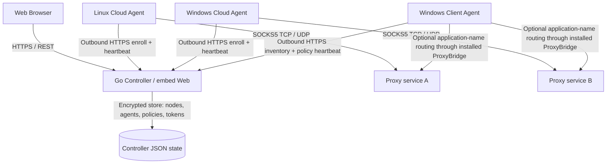

# NodeSwarm v1.2 architecture and control boundaries

## Distributed topology

**Control plane:** authenticated 7-second outbound HTTPS heartbeats, desired `revision`, observed runtime; Controller is not a packet relay.

**Data plane:** a SOCKS5 client connects directly to a Cloud Agent's public proxy listener. The service does not encrypt the proxy payload. Use ACLs and cloud firewalls to restrict source IPs. UDP needs its fixed relay port range permitted inbound.

## Registry and agent roles

The Go binary supports three explicit run modes: `controller`, `agent` (Cloud SOCKS5 service), and `client` (Windows process monitor). Separate install scripts and process lifecycles are provided; they currently share one Go codebase and embedded Web assets. Registered agents persist a `kind`: `cloud` or `client`. Legacy v1.1 agents without a kind load as `cloud`. Each agent role uses separate credentials in its own data directory, and a credential registered for one role cannot be reused by the other role.

### Cloud Agent

1. Register one-use credential and report metrics to Controller.
2. Fetch desired `ProxyConfig` and monotonic revision.
3. Start/stop/restart the embedded Go SOCKS5 TCP+UDP service.
4. Report status, last error, listen address, revision, connection counts and bytes.
5. Stop the service after prolonged control-plane loss (fail-closed after 10 minutes), or immediately after a revoked token yields HTTP 401.

### Windows Client Agent

1. Register as `kind=client` and scan chosen target executable names.
2. Return inventory `{pid, startTime, name, path}` limited to 128 items (12-second cache).
3. Admin chooses bindings via `PUT /api/clients/{id}/bindings`. Controller validates the *latest observed* process identity, enabled/valid node, and per-node capacity across clients.
4. Controller returns a `ClientPolicy` with only the bound SOCKS5 endpoints and credentials to the authenticated Client Agent, never to the admin dashboard.
5. Client executes **observe** (default, no traffic changed) or the optional *by-process-NAME* ProxyBridge integration. Conflicts are rejected instead of silently routing incorrectly; the engine's status never claims PID-level enforcement.
6. Client reports per-binding route state. Invalidated PID identities are pruned from Controller policy on a fresh successful process inventory.

## Persistence

- `registry.key` + `agents.json`: Cloud Agent and Client identity, hashed agent tokens, AES-GCM encrypted cloud SOCKS5 credentials, desired revisions, Client bindings, observed status.
- `local.key` + `nodes.json`: encrypted SOCKS5 node inventory and audit events.
- `alert-mutes.json`: muted alert identifiers and deadlines.
- Client workstation `agent.json`: unique agent ID, token, Controller and registered role; saved via atomic replace at mode 0600.
- `admin.token` / `enroll.token`: Administrator and legacy enrollment keys, separate from per-agent credentials.

All file permissions and backups are the deployer's responsibility. This is a **single-Controller local-file system**, not a horizontally scalable multi-controller database/HA cluster.

## Security

- HTTPS for remote control channels; Agent heartbeat and admin authorization use different credentials.
- Only the authenticated target Client receives its bound node credentials, over HTTPS.
- No shell command, remote desktop or arbitrary code execution API is exposed.
- Windows Client's default `observe` backend is non-invasive. The optional ProxyBridge backend runs with explicit binary path and fixed CLI arguments, writes its profile only inside the restricted data directory, and exposes status `process_name_unverified`.
- Neither a stored binding nor an application-name rule proves game traffic egress; real-PID transparent routing, DNS/IPv6 escape tests, game compatibility and public VPS network tests require actual Windows host verification.

## Main code and API

| Component | Path | Responsibility |
|---|---|---|
| Controller routing | `main.go`, `api_agents.go`, `api_clients.go` | Authentication, REST and desired state |
| Persistent registry | `internal/control/` | Enrollment, roles, bindings, status and encrypted credentials |
| Cloud and Client heartbeat | `internal/agent/` | Remote communication and agent lifecycle |
| Windows Client routing adapter | `internal/client/` | Inventory and optional ProxyBridge CLI profiles |
| Cloud SOCKS5 | `internal/proxy/` | Authenticated TCP and UDP service |
| Proxy nodes and health tests | `internal/manager/`, `internal/monitor/` | Inventory and connectivity checks |
| Web UI | `web/` | Dashboard, cloud fleet, client fleet, alerts and settings |
| Runtime installations | `deploy/` | Linux systemd, Windows scheduled tasks, Docker examples |

See `CLIENT_AGENT.md` for operational detail, explicit route statuses and Windows verification steps.
